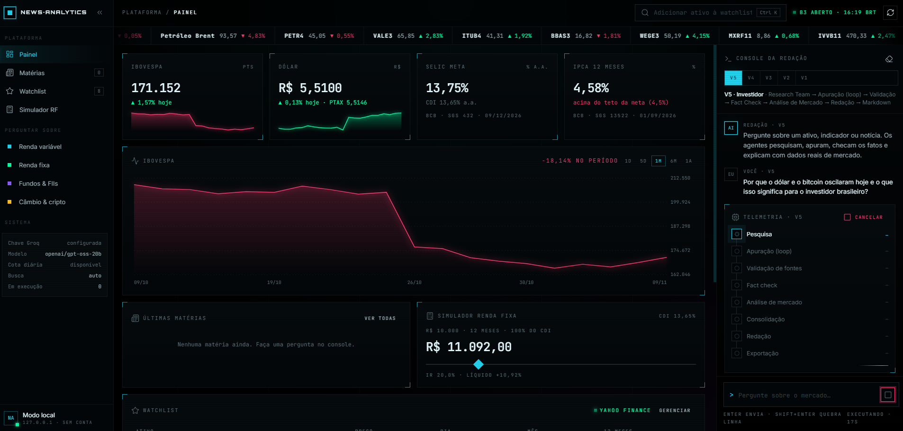
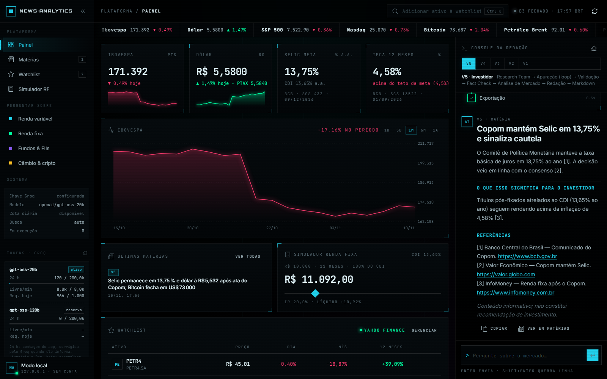
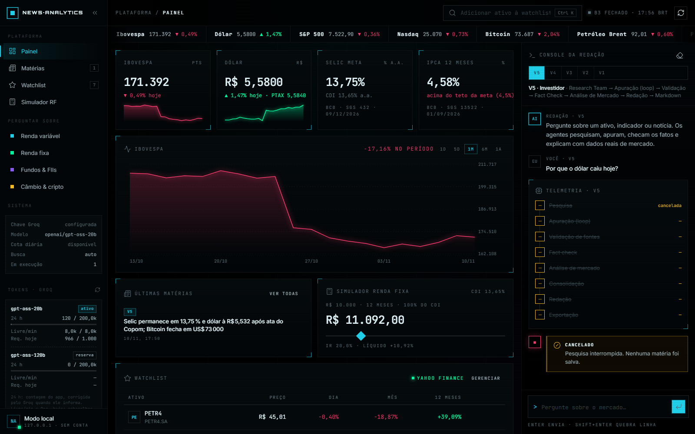
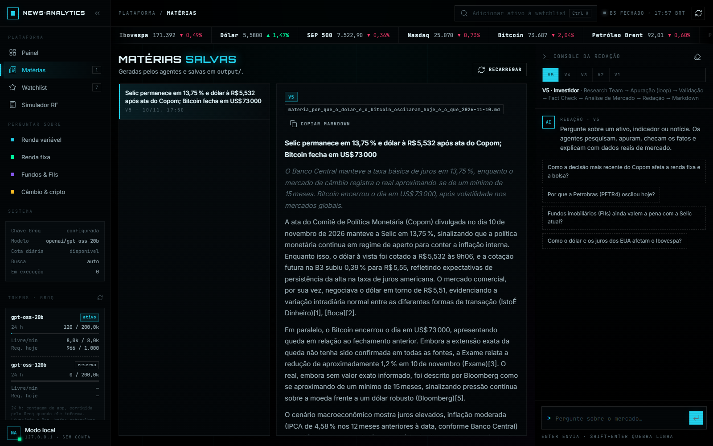
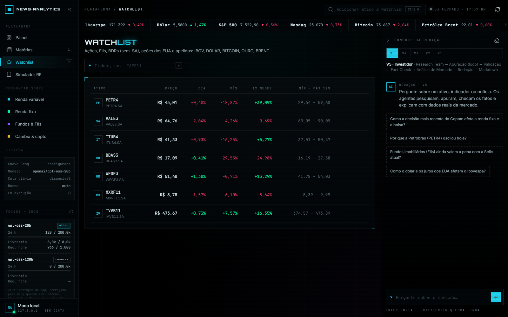
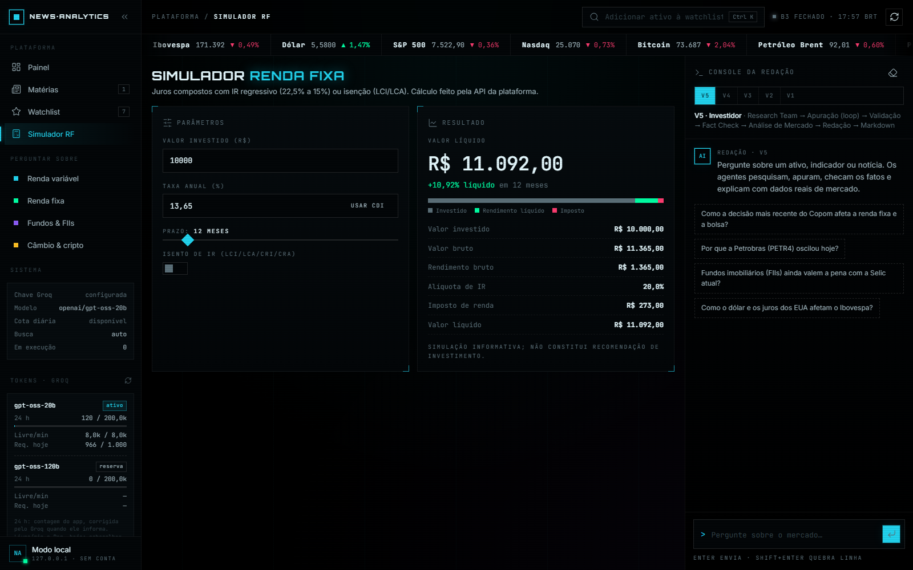

# 📈 News Analytics Platform — Notícias e Inteligência para Investidores

Plataforma de notícias do **mercado financeiro** baseada em agentes de IA (**Agno** + **Groq**), feita para ajudar investidores a entender o que move **ações, renda fixa, renda variável, fundos, câmbio, cripto e a economia**.

Uma redação de agentes especializados pesquisa a notícia, apura em múltiplas fontes, checa os fatos, cruza com **dados reais de mercado** (cotações da B3 e globais, Selic, CDI, IPCA, dólar) e entrega uma matéria clara, com a seção **"O que isso significa para o investidor"**. Temas fora do mercado também são aceitos.

> Conteúdo informativo; não constitui recomendação de investimento.

---

## 🚀 O que a plataforma faz

- Encontra a notícia mais relevante sobre um ativo, indicador ou tema ("Por que PETR4 caiu?", "Copom e a Selic", "FIIs").
- Apura em veículos especializados (Valor, InfoMoney, Bloomberg Línea, Reuters...) e fontes oficiais (B3, CVM, Banco Central).
- Verifica números: cotações e indicadores são conferidos com dados oficiais.
- Analisa o impacto por classe de ativo, com painel de mercado e glossário.
- Redige a matéria com referências numeradas e salva em Markdown.
- Interface **Quantum Terminal** (HTML/CSS/JS puro): painel com Ibovespa, dólar, Selic, CDI, IPCA, gráfico intradiário, watchlist, simulador de renda fixa, matérias salvas e console da redação com a **telemetria do pipeline em tempo real**.

---

## 🖥️ Telas

**Painel** — mercado ao vivo, gráfico do Ibovespa, simulador, watchlist e o console da redação acompanhando o pipeline da V5:



| | |
|---|---|
|  **Console da redação** — a matéria chega formatada, com links e referências (exemplo com dados ilustrativos). |  **Cancelamento** — o botão de enviar vira *Cancelar*; as etapas restantes são interrompidas e nada é salvo. |
|  **Matérias** — lista e leitor das matérias salvas em `output/`. |  **Watchlist** — ações, FIIs, BDRs, índices e cripto com variação do dia, do mês e de 12 meses. |
|  **Simulador de renda fixa** — juros compostos com IR regressivo ou isenção (LCI/LCA). | **Sidebar** — status do sistema e o card **Tokens · Groq** com o consumo de 24 h, os tokens livres por minuto e as requisições restantes de cada modelo. |

---

# 🏗️ Arquitetura

O projeto evolui por versões, cada uma explorando uma arquitetura de agentes. Todas estão disponíveis no seletor do chat.

| Versão | Arquitetura |
|---|---|
| **V5 — Investidor** (padrão) | Research Team de mercado → Apuração (loop) → Validação → Fact Check com dados → **Analista de Investimentos** → Redação → Markdown |
| V4 — Multi-Agent Research Pipeline | Research Team → Apuração (loop) → Validação → Fact Check → Redação → Markdown |
| V3 — Loop + Fact Check | Pesquisa → Apuração (loop até 3 fontes) → Verificação → Redação |
| V2 — Workflow | Pesquisador → Apurador → Verificador → Redator |
| V1 — Agente único | Um agente executa todas as etapas |

## V5 — Investidor

```text
Pergunta do investidor
 ↓
Research Team (Pesquisador Brasil + Pesquisador Global)
 ↓
Apuração ──► fontes suficientes? ──não──► repete (até 2x)
 ↓ sim
Validação de fontes (código, sem LLM)
 ↓
Fact Check (busca + cotações/indicadores)
 ↓
Analista de Investimentos (painel, impacto por classe, riscos, glossário)
 ↓
Redação ("O que isso significa para o investidor")
 ↓
Markdown em output/V5/
```

---

# 🤖 Agentes e skills

| Skill | Papel |
|---|---|
| `pesquisa-noticias` | Notícia principal, ativos/indicadores envolvidos e palavras-chave |
| `apuracao-fontes` | Dossiê: fontes, números-chave, linha do tempo, consensos e contradições |
| `verificacao-factual` | Fatos confirmados/disputados, dados de mercado conferidos, alerta ao redator |
| `analise-mercado` | Painel de mercado, impacto em renda variável/fixa/fundos/câmbio, riscos, glossário |
| `redacao-jornalistica` | Matéria de 450–700 palavras com seção para o investidor e referências |

## 📊 Ferramentas de mercado (`agente/ferramentas_mercado.py`)

Gratuitas e sem chave de API:

| Ferramenta | Fonte | Exemplo |
|---|---|---|
| `cotacao_ativo` | Yahoo Finance (API pública de gráficos) | PETR4, VALE3, MXRF11 (FII), AAPL34 (BDR), AAPL, IBOV, DOLAR, BITCOIN |
| `indicadores_economicos` | Banco Central (SGS) | Selic meta, CDI, IPCA 12 meses, dólar PTAX |
| `panorama_mercado` | Yahoo Finance | Ibovespa, dólar, S&P 500, Nasdaq, Bitcoin, Brent |
| `simular_investimento_renda_fixa` | cálculo local | CDB/Tesouro com IR regressivo, LCI/LCA isentas |

---

# 🛠️ Tecnologias

- **Python** 3.12 ou 3.13 (oficial, python.org / Python Install Manager)
- **Agno** 2.4.8: Agent, Team, Workflow, Step, Loop
- **Groq**: `openai/gpt-oss-20b` (configurável)
- **Busca**: `ddgs` (backend `auto`)
- **Dados de mercado**: API pública de gráficos do Yahoo Finance (endpoints `spark`/`chart`, em lote) + API SGS do Banco Central
- **API**: FastAPI + Uvicorn (JSON + Server-Sent Events)
- **Interface**: HTML, CSS e JavaScript puros, sem build — design system **Quantum Terminal** (`design/design_system1.html`)
- **Testes**: pytest + FastAPI TestClient + GitHub Actions

---

# 📂 Estrutura do Projeto

```text
News_Analytics_Platform/
├── agente/
│   ├── comum.py                 # configuração compartilhada (modelo, busca, skills, caminhos)
│   ├── passos.py                # passos de workflow reutilizáveis
│   ├── ferramentas_mercado.py   # cotações, indicadores BCB, simulador de renda fixa
│   ├── uso_groq.py              # medidor de tokens e limites do Groq (card da sidebar)
│   ├── agente_curador.py        # V1
│   ├── agente_curador_v2.py     # V2
│   ├── agente_curador_v3.py     # V3
│   ├── agente_curador_v4.py     # V4
│   └── agente_curador_v5.py     # V5 — Investidor
├── skills/                      # pesquisa, apuração, verificação, análise de mercado, redação
├── api/
│   ├── servidor.py              # FastAPI: rotas /api/* e o front-end
│   ├── execucao.py              # perguntas em segundo plano + eventos do pipeline
│   ├── registry.py              # versões V1–V5 (import sob demanda)
│   └── __main__.py              # python -m api
├── web/                         # front-end Quantum Terminal (index.html, css/, js/)
├── design/                      # design systems 1–3 e referências visuais
├── docs/                        # capturas de tela usadas neste README
├── tests/                       # pytest (sem LLM e sem rede)
├── .github/workflows/           # CI: testes automáticos
└── output/                      # matérias geradas (ignorado pelo git)
```

---

# ⚙️ Instalação

```bash
git clone https://github.com/GuiMRDS/News_Analytics_Platform.git
cd News_Analytics_Platform
uv sync
```

> **Windows com Smart App Control:** o Windows bloqueia o Python baixado pelo uv e os executáveis gerados em `.venv\Scripts` (`DLL load failed ... Uma política de Controle de Aplicativo bloqueou este arquivo`). Por isso o projeto usa `python-preference = "only-system"`. Instale o Python oficial (`py install 3.13` ou python.org), rode `uv sync` e execute as ferramentas sempre via `python -m` (`python -m api`, `python -m pytest`).

# 🔑 Configuração

Copie o `.env.example` para `.env`:

```env
GROQ_API_KEY=sua_chave
# opcionais
GROQ_MODEL_ID=openai/gpt-oss-20b            # modelo principal
GROQ_MODELOS_RESERVA=openai/gpt-oss-120b     # usados quando a cota diária do principal acaba (vazio desativa)
BUSCA_BACKEND=auto
```

Obtenha a chave em https://console.groq.com.

> **Limites do plano gratuito do Groq (por modelo):** 8.000 tokens por minuto, 1.000 requisições por dia e **200.000 tokens por dia** (janela móvel de 24 h). Cada chamada de ferramenta é uma nova requisição ao modelo, então um workflow completo leva vários minutos e consome boa parte da cota diária.

### Cota diária e modelos reserva

Como cada modelo tem a sua própria cota diária, quando o modelo principal esgota os agentes **trocam sozinhos** para o próximo de `GROQ_MODELOS_RESERVA`, no meio da execução e sem esperar. Se todos estiverem esgotados, a pergunta é recusada na hora com o tempo até a cota liberar, em vez de rodar um pipeline que vai falhar.

O card **Tokens · Groq** na sidebar mostra, para cada modelo:

- **24 h**: tokens usados / 200 mil. É a contagem do app (o `usage` de cada resposta), corrigida pelo valor oficial do Groq sempre que ele o informa num erro 429. Fica salva em `output/.uso_groq.json`.
- **Livre/min**: tokens por minuto ainda livres, lidos do cabeçalho `x-ratelimit-remaining-tokens` da última resposta.
- **Req. hoje**: requisições restantes no dia, do cabeçalho `x-ratelimit-remaining-requests`.
- O botão ⟳ consulta os limites atuais no Groq agora, com uma chamada mínima que gasta ~10 tokens por modelo.

---

# ▶️ Executando

```bash
uv run python -m api                              # Quantum Terminal em http://127.0.0.1:8000
uv run python -m api --port 8080 --reload         # outra porta / recarregar ao editar
uv run python -m agente.agente_curador_v5         # V5 no terminal, sem interface
```

Abra **http://127.0.0.1:8000**. No console da redação (à direita), escolha a versão dos agentes (V1–V5), use uma sugestão ou pergunte sobre qualquer ativo/tema: cada etapa do pipeline acende conforme os agentes trabalham e a matéria chega formatada, com links. O painel de mercado funciona mesmo sem a `GROQ_API_KEY`.

A documentação interativa da API fica em **http://127.0.0.1:8000/api/docs**.

### Cancelar uma pergunta

Durante a execução, o botão de enviar vira **Cancelar** (também há um botão no cartão de telemetria, e a tecla **Esc** funciona). Se a pergunta ainda está sendo enviada, o envio é abortado. Se a pesquisa já começou, os agentes em execução são interrompidos entre as chamadas ao modelo, o workflow não avança e **nenhuma matéria é salva**. A chamada ao modelo que já estava em andamento termina antes de parar.

### Matérias salvas

1. A última etapa de cada workflow (V4/V5: `exportacao`; V1–V3: o redator, pela ferramenta de arquivos) grava a matéria em `output/<versão>/materia_<tema>_<data>.md`.
2. A API lista esses arquivos em `GET /api/materias` (mais recentes primeiro; o título é a primeira linha da matéria) e entrega o conteúdo em `GET /api/materias/<versão>/<arquivo>`.
3. No Quantum Terminal, as matérias aparecem em **Últimas matérias** (painel) e na tela **Matérias**, com o leitor formatado e o botão **Copiar markdown**. A lista é recarregada sozinha quando uma pergunta termina.
4. Os arquivos ficam no seu disco (a pasta `output/` não vai para o git) e podem ser abertos em qualquer editor de Markdown. Para apagar uma matéria, basta apagar o arquivo.
5. Perguntas canceladas ou com erro não geram arquivo.

## Testes

```bash
uv run python -m pytest
```

Os testes não chamam o LLM, a web ou as APIs de mercado (tudo simulado) e rodam no GitHub Actions a cada push/PR.

---

# 💡 Conceitos explorados

Multi-Agent Systems · Agent Engineering · Workflow Orchestration · Fact Checking assistido por IA · Tool Calling com dados reais · Modularização por Skills · Otimização de tokens para rate limits

---

# 👨‍💻 Autor

**Guilherme Marinho**

Software Engineer | Python | IA & Automação | C# .NET | Cloud | Cybersecurity

GitHub: https://github.com/GuiMRDS
LinkedIn: https://www.linkedin.com/in/guilhermemrds/

---

⭐ Se este projeto foi útil para você, considere deixar uma estrela no repositório.
